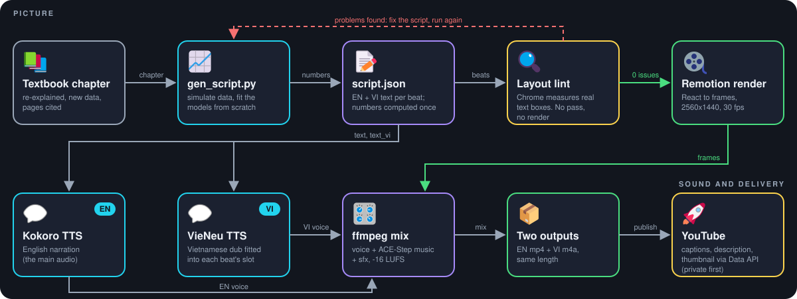
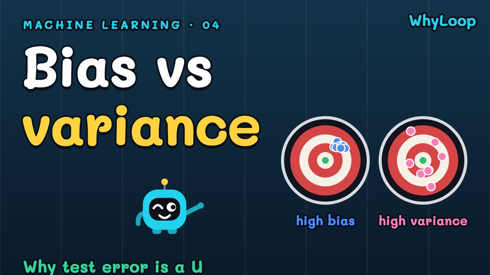
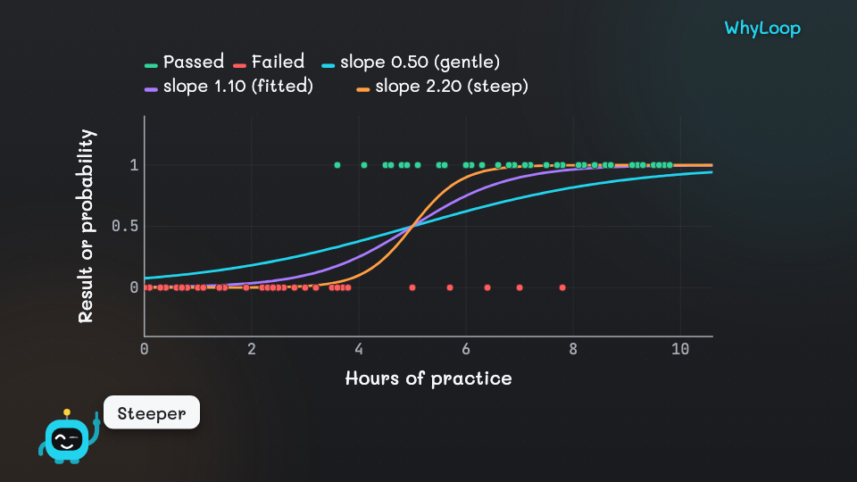
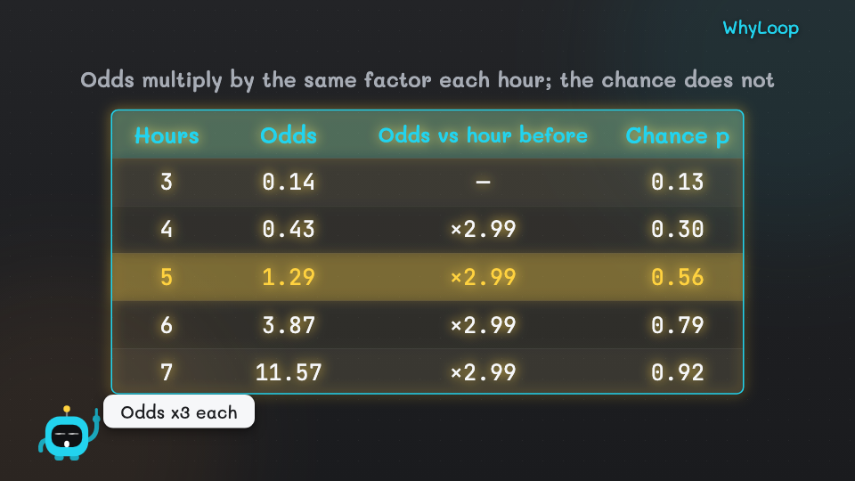

# WhyLoop · an automated pipeline that turns a textbook into bilingual explainer videos

WhyLoop is a one-person video studio written as code. It takes a chapter of a machine-learning textbook and produces a
finished YouTube episode: a script whose numbers are computed, English narration, a Vietnamese dub, animated diagrams,
music, thumbnail, captions and upload metadata. Everything renders locally.

**Channel:** [WhyLoop on YouTube](https://www.youtube.com/channel/UCxnTeZD7YM3adHAdMTf2kpQ) · *"Ask why. Then ask again."*

| | |
|---|---|
| Episodes | 14 public, 16 scripted (Machine Learning series, 36 planned) |
| Content | 967 animated beats in the 16 scripts, about 2.5 hours of rendered video |
| Output | 2560×1440, English picture with English audio, plus a same-length Vietnamese audio track |
| Code | about 6.7k lines of TypeScript, Python and JS (Remotion front end, Python engine) |

<p align="center"></p>

*One script feeds both the picture and the sound. The layout lint stops a bad render before it starts (red loop).*



## What I built

- **A script generator per episode** (`gen_script.py` in each episode folder). It simulates the data, fits the models
  from scratch (for example logistic regression by Newton/IRLS), and writes `script.json`. Every number on screen and in
  the voice-over comes from the same computed value, so picture and narration cannot disagree.
- **A scene engine in Remotion** (`src/`). Scripts are JSON; the engine draws plots, tables, equations (KaTeX), icons and
  the mascot Bít, and animates them in step with the narration.
- **A bilingual audio stack.** English narration with Kokoro TTS, Vietnamese dub with VieNeu-TTS. The dub is fitted into
  each beat's time slot, and a report flags any line that had to be cut so the script can be shortened.
- **A layout linter that looks at real pixels** (`scripts/lint_frames.mjs`). It renders the end of every beat in headless
  Chrome with the real theme and font, measures element boxes, and fails the build on text over text, text crossing a
  frame border, text off-screen, or text in the logo corner. `render` refuses to start until it prints zero problems.
- **A CLI that runs the whole chain** (`./make-video`): check, lint, render, captions, catalog, YouTube upload (Data API
  v3, dry-run first, public by default), with progress tracking safe for parallel renders.
- **Brand and asset tooling:** a themed design system, intro/outro clips cached per voice, a licence-filtered icon
  library of about 730 icons, and a thumbnail generator that draws a real-life metaphor scene per episode.

## What it looks like

Frames from episode 13 (logistic regression), taken by the linter. Both are checked automatically before rendering.

| Plot | Table |
|---|---|
|  |  |

More thumbnails: [#5](docs/img/thumb-05.jpg), [#13](docs/img/thumb-13.jpg), [#14](docs/img/thumb-14.jpg).

## Problems I had to solve

- **Layout bugs I could not see by eye.** A label wrapped onto the next icon and passed my first lint, which used the
  wrong theme. The lint now shares the exact theme and font of the real render.
- **Non-integer render height.** Rendering at 2K with a decimal scale made Remotion fail; the scale must be exactly 4/3.
- **Pronunciation.** The TTS read "WhyLoop" like "qui-loop". A pronunciation dictionary (`pronunciation*.json`) fixes
  the channel name and technical terms without matching single letters inside Vietnamese words.
- **Dub timing.** Vietnamese is longer than English. The dub is fitted per beat and reported, instead of stretching audio.
- **Copyright.** The source book is under copyright, so the repo stores only metadata. Episodes re-explain it with new
  examples and synthetic data, redraw every figure, and cite page numbers.

## Repo map

```
make-video           CLI entry point
scripts/             engine (make_video.py), linter, captions, YouTube upload, TTS, music, catalog
src/                 Remotion app: scenes, diagrams, mascot, math, thumbnails, theme
series/<s>/episodes/ per episode: gen_script.py, script.json, description, captions, thumbnail, youtube.json
                     (episode content is kept out of this public repo; the videos are on the channel)
assets/              brand, icon library with attribution, sound effects
templates/           script templates (compare-two, feedback-loop, math-plot ...)
docs/USAGE.md        full operating manual (Vietnamese)
LICENSES.md          licence and copyright review of every component
CLAUDE.md            the rules the AI assistant follows when making an episode
```

## Install

Developed and tested on macOS (Apple Silicon, M4 Pro, 48 GB). Linux and Windows are untested. Models are downloaded on
first use, so the first run needs internet and several GB of disk.

**1. Prerequisites**

```bash
brew install uv node ffmpeg espeak-ng     # espeak-ng is needed by the English voice (Kokoro)
```

**2. Get the code and the tools**

```bash
git clone https://github.com/FluteInTheRain/whyloop.git && cd whyloop
./scripts/setup.sh    # clones VieNeu-TTS and ACE-Step into tools/, makes the Kokoro venv, npm install, builds sound effects
```

**3. Things the repo does not ship** (media, music and voice samples are generated or yours)

```bash
./make-video voice add my-voice.wav --name "Me"   # optional: clone your own Vietnamese voice (VieNeu presets work without it)
uv run --project tools/acestep python scripts/gen_music.py --duration 40 --out assets/music/lofi_chill.wav \
  --caption "lo-fi hip hop, mellow electric piano, soft drums, warm vinyl texture, relaxed study beat"   # base music track (ACE-Step)
./make-video brand build                          # intro and outro clips
npm run studio                                    # open Remotion Studio to check that rendering works
```

**4. Make an episode**

Open Claude Code in the project folder and run `/make-video <topic>`. It writes `series/<series>/episodes/<NN-slug>/script.json`
(start from a file in `templates/`), then:

```bash
./make-video check  series/<series>/episodes/<episode>
./make-video lint   series/<series>/episodes/<episode> --png   # must print "0 vấn đề" (0 problems)
./make-video render series/<series>/episodes/<episode>         # also re-runs the lint and refuses on problems
```

Uploading needs your own Google OAuth client; credentials live in `~/.config/whyloop/`, never in the repo. Full steps for
every command, voice mixing, the book workflow and YouTube are in the [usage manual](docs/USAGE.md).
Episode folders are not part of this public repo, so the commands above need an episode you create yourself.

## How AI was used

The episodes are written and rendered with Claude Code, driven by project skills (`.claude/skills/`) and the rules in
`CLAUDE.md`. The engineering decisions (data-driven scripts, pixel-level lint, bilingual dub fitting) are mine; the
assistant executes them under those rules.

## Limits

Visuals are vector animation only, with no live-action footage or AI-generated images. Narration length varies by
10-15% from the estimate, and TTS pronunciation is not guaranteed. The Vietnamese preset voices have licence questions
noted in [LICENSES.md](LICENSES.md).

## Licence

The source code is MIT-licensed ([LICENSE](LICENSE)). Not covered by it: the WhyLoop name, the mascot Bít and `assets/brand/`
(all rights reserved); the third-party icons in `assets/library/` (each set keeps its own licence, see
`assets/library/ATTRIBUTION.md`); and the tools the project builds on (Remotion, VieNeu-TTS, ACE-Step, Kokoro, ffmpeg).
Remotion has its own terms for larger companies. Details: [LICENSES.md](LICENSES.md).

## Credits

Content follows *An Introduction to Statistical Learning* (James, Witten, Hastie, Tibshirani; Springer, 2013), re-written
with original examples. Third-party tools and licences: see [LICENSES.md](LICENSES.md).
