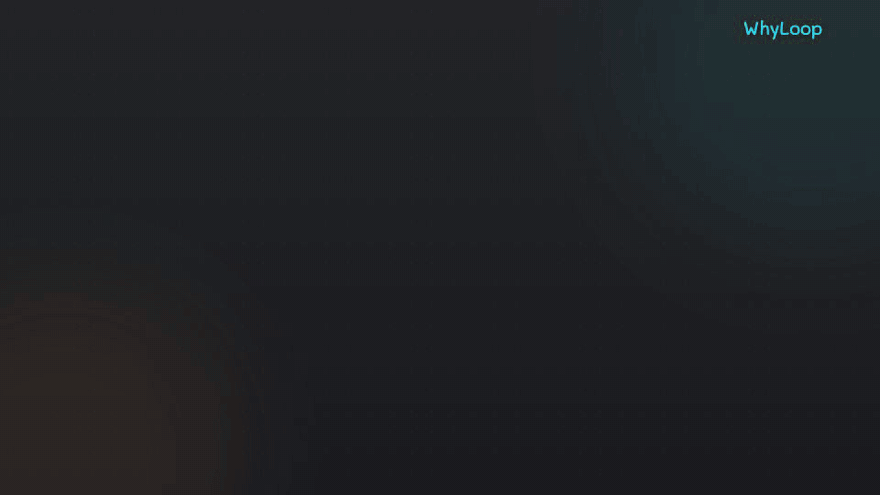
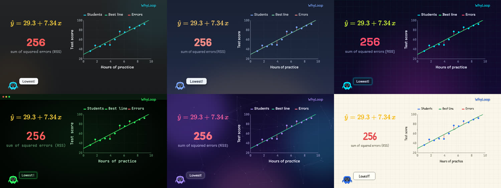
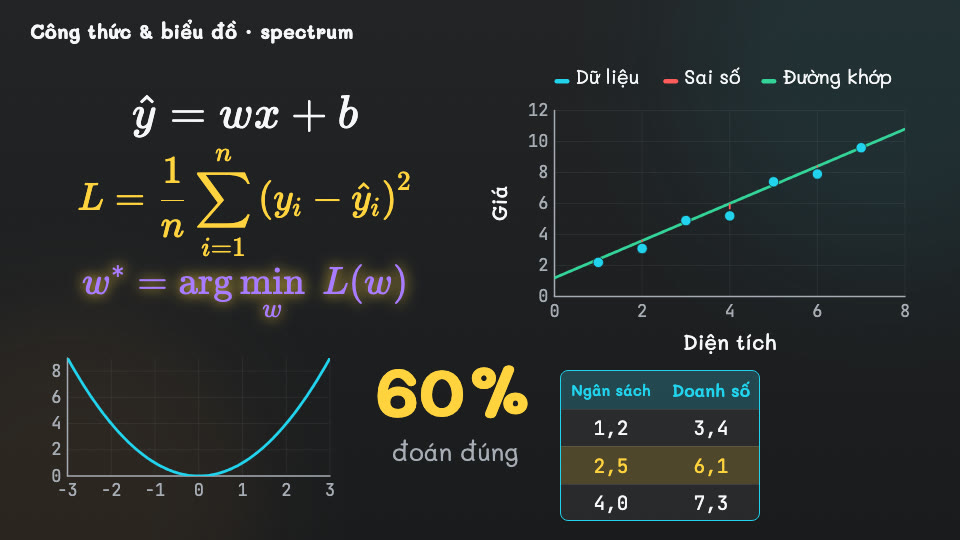
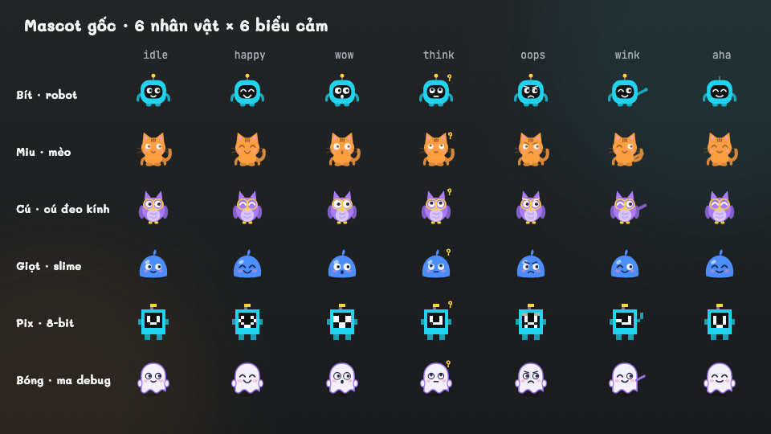

# 🔁 WhyLoop: Textbook-to-YouTube Explainer Video Pipeline

<div align="center">

[](scripts/make_video.py)
[](src/)
[%20%2B%20VieNeu%20(VI)-8B5CF6)](#-how-it-works)
[](#-how-it-works)
[](https://www.youtube.com/channel/UCxnTeZD7YM3adHAdMTf2kpQ)
[](LICENSE)

<b>A one-person video studio written as code: a textbook chapter goes in, a finished bilingual YouTube episode comes out,<br/>rendered entirely on a laptop.</b>

[**🔄 How it works**](#-how-it-works) •
[**📺 Episodes**](#-episodes) •
[**🧱 Engine**](#-engine-building-blocks) •
[**📋 Requirements**](#-requirements) •
[**📦 Install**](#-installation) •
[**🚀 Usage**](#-usage) •
[**🔧 Config**](#-configuration) •
[**📁 Structure**](#-project-structure)



<sub><i>Rendered by this engine from <a href="docs/demo/gen_demo.py">docs/demo/gen_demo.py</a>: every number on screen is computed from the same simulated data.</i></sub>

</div>

---

## ✨ At a Glance

| | |
|---|---|
| 🧮 **Computed scripts** | A generator per episode simulates data and fits the models, so picture and narration share one number |
| ⏱️ **Audio sets the pace** | Each beat is spoken first; its audio length becomes its length on screen |
| 🔍 **Pixel lint gate** | Headless Chrome renders every beat and measures text boxes; any overlap blocks the render |
| 🌐 **Bilingual** | English picture + English audio, plus a same-length Vietnamese dub track fitted beat by beat |
| 📤 **Publish kit** | Thumbnail, captions (EN/VI), description, YouTube upload via Data API |

---

## 🔄 How It Works

<p align="center">
  
</p>

| Stage | Tool | Output |
|---|---|---|
| Script | `gen_script.py` → `script.json` | Beats: `text` (EN), `text_vi` (VI), `do` (what changes on screen) |
| Gate | `check` + `lint` (headless Chrome) | Must print `0 vấn đề` (0 problems) or nothing renders |
| Voice | Kokoro-82M (EN), VieNeu-TTS (VI, voice cloning) | One WAV per beat; its length sets the beat's frames |
| Picture | Remotion 4 (React → frames) | 2560×1440 @ 30 fps; intro/outro cached and joined by stream copy |
| Sound | ACE-Step music + FFmpeg | Music 8 dB under the voice, −16 LUFS; VI dub squeezed into each beat's slot |

---

## 📺 Episodes

A few of the 22 *Machine Learning* episodes made with this pipeline. **Click a thumbnail to watch**, or see
[all episodes on the channel](https://www.youtube.com/channel/UCxnTeZD7YM3adHAdMTf2kpQ/videos).

<table align="center">
  <tr>
    <td align="center" width="25%"><a href="https://youtu.be/S3yrNzhr9ds"></a><br/><sub><b>#4</b> The Bias-Variance Trade-Off</sub></td>
    <td align="center" width="25%"><a href="https://youtu.be/T7v18poExZU"></a><br/><sub><b>#5</b> Bayes vs KNN</sub></td>
    <td align="center" width="25%"><a href="https://youtu.be/himFbT75CtY"></a><br/><sub><b>#14</b> Simpson's Paradox</sub></td>
    <td align="center" width="25%"><a href="https://youtu.be/rSAI0ScSx40"></a><br/><sub><b>#22</b> The Lasso</sub></td>
  </tr>
</table>

---

## 🧱 Engine Building Blocks

**One script, nine themes.** The same frame of the demo, switched with one flag (`--theme`):

<p align="center"></p>
<p align="center"><sub><code>spectrum</code> · <code>dusk</code> · <code>neon</code> / <code>terminal</code> · <code>ai</code> · <code>sketch</code></sub></p>

| Math nodes: KaTeX, plots, count-up stats, tables | Mascot Bít and friends: 6 characters × 7 expressions |
| :---: | :---: |
|  |  |

| Node types | Beat actions (`do`) | Sound effects, automatic |
|---|---|---|
| `icon` `box` `group` `cells` `pill` `text` `code` `badge` `mascot` `equation` `plot` `stat` `table` | `show` `hide` `clear` `highlight` `flow` `set` `camera` | show → pop · highlight → tick · clear/camera → whoosh · red → buzz · colour → ding · face → boop |

---

## 📋 Requirements

| | Needed | Notes |
|---|---|---|
| **OS** | macOS on Apple Silicon | Developed and tested there. Linux should work (see [cloud notes](docs/CUSTOMIZE.md#4-a-weak-computer-or-the-cloud)); Windows untested |
| **Node.js** | 20+ | Remotion and headless Chrome |
| **uv** | any recent | Runs the Python engine and the TTS / music tool environments |
| **FFmpeg** | any recent | Mixing, loudness, joining clips |
| **espeak-ng** | any recent | Phonemes for the English voice (Kokoro) |
| **Disk / network** | several GB, internet on first run | Models download on first use |
| **GPU** | optional | Only music generation (ACE-Step) really wants one; Apple Silicon is fine |

---

## 📦 Installation

```bash
# 1. System packages (macOS)
brew install uv node ffmpeg espeak-ng

# 2. Code + third-party tools: VieNeu-TTS and ACE-Step into tools/, Kokoro venv, npm install, sound effects
git clone https://github.com/FluteInTheRain/whyloop.git && cd whyloop
./scripts/setup.sh

# 3. Things the repo does not ship
uv run --project tools/acestep python scripts/gen_music.py --duration 40 --out assets/music/lofi_chill.wav \
  --caption "lo-fi hip hop, mellow electric piano, soft drums, warm vinyl texture, relaxed study beat"   # or copy any WAV there
./make-video brand build                            # intro and outro clips (cached)

# 4. Check that rendering works
npm run studio                                      # opens Remotion Studio in the browser
```

<details>
<summary><b>Minimal install (no VieNeu, no ACE-Step, e.g. a weak laptop or a Linux VM)</b></summary>

```bash
npm install
uv venv tools/kokoro/.venv && uv pip install --python tools/kokoro/.venv/bin/python kokoro-onnx soundfile
python3 scripts/make_sfx.py
```

Then render with your own music and no Vietnamese dub (`--music <name> --no-dub`). On a machine without a GPU set
`WHYLOOP_RENDER_GL=swangle`.
</details>

---

## 🚀 Usage

**Your first video** (the bundled 25-second example, no private content needed):

```bash
./make-video check  examples/hello-whyloop          # schema, ending, pronunciation, length estimate
./make-video lint   examples/hello-whyloop --png    # must print "0 vấn đề" (0 problems); images in out/review/
./make-video render examples/hello-whyloop --mode demo --voice "Hải Đăng" --music lofi_chill --no-dub
```

The video lands in `out/`. A progress page opens in the browser while it renders.

**Your own episode:** open Claude Code in the repo and run `/make-video <topic>`, or copy a file from [`templates/`](templates/)
to `series/<series>/episodes/<NN-slug>/script.json`, then run the same `check → lint → render`.

<details>
<summary><b>All commands</b></summary>

| Command | What it does |
|---|---|
| `./make-video check <episode>` | Validate the script, estimate length, warn about layout and pronunciation |
| `./make-video lint <episode> [--png]` | Render the end of every beat and report overlapping or clipped text |
| `./make-video render <episode> [--mode demo] [--voice V] [--music M] [--theme T] [--no-dub]` | Full pipeline to `out/<tag>.mp4` (+ `.vi.m4a`) |
| `./make-video say "text" [--voice V]` | Hear how a line is pronounced |
| `./make-video voice add <audio> --name N` · `list` · `remove` | Clone and manage Vietnamese voices |
| `./make-video brand build [--force]` · `status` | Build or inspect the cached intro / outro |
| `./make-video assets search <words> [--remote]` · `add` · `list` · `sync` | Licence-filtered icon library |
| `./make-video book ingest <file> --slug S --title T` · `page` | Import a reference book |
| `./make-video catalog` · `publish <episode> --url U` | Episode list and status |
| `./make-video youtube auth` · `status` · `upload <episode> [--dry-run]` · `resume` · `public` · `captions` · `delete` | Publish with the YouTube Data API |
| `python3 scripts/captions.py <episode>` | `captions.en.srt` + `captions.vi.srt` from the real timing |

Full manual with every option (Vietnamese): [docs/USAGE.md](docs/USAGE.md).
</details>

**Render time** (M4 Pro, 48 GB): intro + outro first build ≈ 20 s · 30-second demo ≈ 1 to 2 min · full 5-minute video ≈ 3.5 to 5.5 min.

---

## 🔧 Configuration

Everything lives in [`config.json`](config.json); environment variables override the render settings for one run.

| Key | Default | What it controls |
|---|---|---|
| `theme` | `spectrum` | Look of every scene (`--theme` overrides) |
| `render.scale` | `4/3` → 2560×1440 | `1` = 1080p, `2` = 4K. Must be exactly one of these |
| `render.concurrency` / `render.gl` | `10` / `angle` | Remotion processes and GL backend |
| `default_voice`, `voices`, `voice_mixes` | `Khang Mix` | Vietnamese voices and voice blends (`Khang Mix` is the author's own; use `Hải Đăng`) |
| `languages.en.voices` | `am_michael`, `af_heart` | English Kokoro voice paired with each Vietnamese voice |
| `music`, `music_offset_db`, `target_lufs` | 6 tracks, `8`, `-16` | Music beds, music level under the voice, loudness |
| `beat_gap_sec`, `pad_sec`, `fps` | `0.45`, `0.6`, `30` | Pause after a beat, after a scene, frame rate |
| `channel` | WhyLoop | Name, tagline, font, avatar, intro / outro lines |

| Environment variable | Example | Effect |
|---|---|---|
| `WHYLOOP_RENDER_SCALE` | `1` | Render at 1080p for this run |
| `WHYLOOP_RENDER_CONCURRENCY` | `2` | Fewer Remotion processes on a small machine |
| `WHYLOOP_RENDER_GL` | `swangle` | Software GL when there is no GPU |

To make it yours (topic, look, channel, voice, languages) see **[docs/CUSTOMIZE.md](docs/CUSTOMIZE.md)**.

---

## 📁 Project Structure

```text
whyloop/
├── make-video                 # CLI entry point
├── config.json                # Voices, music, timing, render, theme, channel, languages
├── pronunciation*.json        # Pronunciation fixes (Vietnamese, English)
├── scripts/                   # Python engine
│   ├── make_video.py          #   orchestrator: check · lint · render · brand · say · voice
│   ├── lint_props.py          #   script → fixed-length timeline for the linter
│   ├── lint_frames.mjs        #   headless Chrome stills + element boxes per beat
│   ├── lint_report.py         #   boxes → overlap / off-screen problems
│   ├── kokoro_tts.py          #   English TTS worker
│   ├── gen_music.py           #   ACE-Step music generator
│   ├── captions.py            #   SRT captions from real timing
│   ├── youtube.py             #   upload, resume, captions, playlist
│   └── setup.sh               #   reinstall everything not in git
├── src/                       # Remotion app (TypeScript + React)
│   ├── Root.tsx               #   compositions: Main, Thumbnail, sheets, Promo
│   ├── Video.tsx              #   scene timeline, backdrop, brand tag
│   ├── diagram.tsx            #   DiagramScene: beats, edges, camera, lint probe
│   ├── math.tsx               #   plot, equation, stat, table
│   ├── mascot.tsx · icons.tsx #   characters · icons
│   ├── theme.ts               #   9 themes, fonts
│   └── Thumbnail.tsx          #   metaphor-scene thumbnails
├── templates/                 # 10 starter scripts
├── examples/hello-whyloop/    # runnable bilingual example
├── assets/                    # brand, 752-icon library, sound effects
├── docs/                      # USAGE, CUSTOMIZE, demo generator, images
├── .claude/skills/            # /make-video and /plan-series
└── CLAUDE.md                  # rules the AI assistant follows
```

Generated, not in git: `out/` (videos, review images), `public/` (staged audio and icons), `tools/` (third-party models).
Episode content (`series/`) and book material (`books/`) stay out of this public repo.

---

## 🚧 Limitations

- Vector animation only: no live-action footage and no AI-generated images.
- Real narration length differs from the estimate by about 10 to 15%, and TTS pronunciation is not guaranteed (fix words in `pronunciation*.json`).
- The Vietnamese preset voices have open licence questions, noted in [LICENSES.md](LICENSES.md).
- Remotion Lambda / Cloud Run are not wired in: rendering is local.

---

## 👤 Author

**Nguyen Nhat Khang** · GitHub [@FluteInTheRain](https://github.com/FluteInTheRain) ·
YouTube [WhyLoop](https://www.youtube.com/channel/UCxnTeZD7YM3adHAdMTf2kpQ)

---

## 📜 License & Credits

Code: **MIT** ([LICENSE](LICENSE)). Not covered: the WhyLoop name, the mascot Bít and `assets/brand/` (all rights reserved), third-party
icons in `assets/library/` (own licences, see [ATTRIBUTION.md](assets/library/ATTRIBUTION.md)). Details: [LICENSES.md](LICENSES.md).
Content follows *An Introduction to Statistical Learning* (James, Witten, Hastie, Tibshirani; Springer, 2013), re-written with original
examples and synthetic data. Built on Remotion, Kokoro-82M, VieNeu-TTS, ACE-Step and FFmpeg.

---
<div align="center">
  <sub>Built by Nguyen Nhat Khang • <i>Ask why. Then ask again.</i></sub>
</div>
