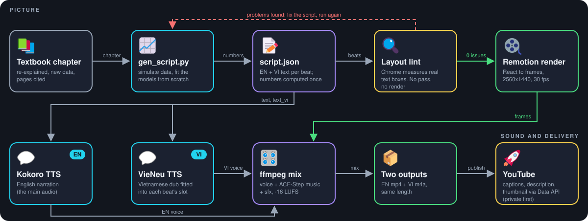

# 🔁 WhyLoop: Textbook-to-YouTube Explainer Video Pipeline

<div align="center">

[](scripts/make_video.py)
[](src/)
[%20%2B%20VieNeu%20(VI)-8B5CF6)](#-how-it-works)
[](#-how-it-works)
[](https://www.youtube.com/channel/UCxnTeZD7YM3adHAdMTf2kpQ)
[](LICENSE)

<b>A one-person video studio written as code: a textbook chapter goes in, a finished bilingual YouTube episode comes out,<br/>rendered entirely on a laptop.</b>

[**🔄 How it works**](#-how-it-works) •
[**📺 Episodes**](#-episodes) •
[**🧱 Engine**](#-engine-building-blocks) •
[**🚀 Quickstart**](#-quickstart) •
[**🎨 Make it yours**](#-make-it-yours)


<sub><i>Rendered by this engine from <a href="docs/demo/gen_demo.py">docs/demo/gen_demo.py</a>: every number on screen is computed from the same simulated data.</i></sub>

</div>

---

## ✨ At a Glance

| | |
|---|---|
| 🧮 **Computed scripts** | A generator per episode simulates data and fits the models, so picture and narration share one number |
| ⏱️ **Audio sets the pace** | Each beat is spoken first; its audio length becomes its length on screen |
| 🔍 **Pixel lint gate** | Headless Chrome renders every beat and measures text boxes; any overlap blocks the render |
| 🌐 **Bilingual** | English picture + English audio, plus a same-length Vietnamese dub track fitted beat by beat |
| 📤 **Publish kit** | Thumbnail, captions (EN/VI), description, YouTube upload via Data API |

---

## 🔄 How It Works

<p align="center">
  
</p>

| Stage | Tool | Output |
|---|---|---|
| Script | `gen_script.py` → `script.json` | Beats: `text` (EN), `text_vi` (VI), `do` (what changes on screen) |
| Gate | `check` + `lint` (headless Chrome) | Must print `0 vấn đề` (0 problems) or nothing renders |
| Voice | Kokoro-82M (EN), VieNeu-TTS (VI, voice cloning) | One WAV per beat; its length sets the beat's frames |
| Picture | Remotion 4 (React → frames) | 2560×1440 @ 30 fps; intro/outro cached and joined by stream copy |
| Sound | ACE-Step music + FFmpeg | Music 8 dB under the voice, −16 LUFS; VI dub squeezed into each beat's slot |

---

## 📺 Episodes

22 episodes of the *Machine Learning* series, every one produced by this pipeline. **Click a thumbnail to watch.**

<table align="center">
  <tr>
    <td align="center" width="25%"><a href="https://youtu.be/X3vczOBjwD4"></a><br/><sub><b>#1</b> What Is Statistical Learning?</sub></td>
    <td align="center" width="25%"><a href="https://youtu.be/sLPFz0QWKJM"></a><br/><sub><b>#2</b> Flexible or Readable?</sub></td>
    <td align="center" width="25%"><a href="https://youtu.be/8vmG6URqAoY"></a><br/><sub><b>#3</b> What Makes a Model Good?</sub></td>
    <td align="center" width="25%"><a href="https://youtu.be/S3yrNzhr9ds"></a><br/><sub><b>#4</b> The Bias-Variance Trade-Off</sub></td>
  </tr>
  <tr>
    <td align="center" width="25%"><a href="https://youtu.be/T7v18poExZU"></a><br/><sub><b>#5</b> Bayes vs KNN</sub></td>
    <td align="center" width="25%"><a href="https://youtu.be/FFw1XGlprRo"></a><br/><sub><b>#6</b> The Best Straight Line</sub></td>
    <td align="center" width="25%"><a href="https://youtu.be/Pkam2Udb_L8"></a><br/><sub><b>#7</b> What a 95% CI Really Means</sub></td>
    <td align="center" width="25%"><a href="https://youtu.be/HH4aVVReehk"></a><br/><sub><b>#8</b> What R² Really Tells You</sub></td>
  </tr>
  <tr>
    <td align="center" width="25%"><a href="https://youtu.be/QN-MGNmrb7o"></a><br/><sub><b>#9</b> Multiple Regression</sub></td>
    <td align="center" width="25%"><a href="https://youtu.be/mc6sJTRU3W4"></a><br/><sub><b>#10</b> Words and Curves in a Linear Model</sub></td>
    <td align="center" width="25%"><a href="https://youtu.be/FDEQnuExGQM"></a><br/><sub><b>#11</b> Your Regression Might Be Lying</sub></td>
    <td align="center" width="25%"><a href="https://youtu.be/4-J0a049ktg"></a><br/><sub><b>#12</b> Draw a Line or Ask the Neighbours?</sub></td>
  </tr>
  <tr>
    <td align="center" width="25%"><a href="https://youtu.be/pK2aYHc2Y-M"></a><br/><sub><b>#13</b> Why a Line Can't Predict Yes/No</sub></td>
    <td align="center" width="25%"><a href="https://youtu.be/himFbT75CtY"></a><br/><sub><b>#14</b> Simpson's Paradox</sub></td>
    <td align="center" width="25%"><a href="https://youtu.be/-cmYBP5j0H0"></a><br/><sub><b>#15</b> Fake Banknotes: LDA</sub></td>
    <td align="center" width="25%"><a href="https://youtu.be/94gjdesxqM0"></a><br/><sub><b>#16</b> QDA &amp; Choosing a Classifier</sub></td>
  </tr>
  <tr>
    <td align="center" width="25%"><a href="https://youtu.be/eJ0e5eAF95U"></a><br/><sub><b>#17</b> Leave-One-Out Cross-Validation</sub></td>
    <td align="center" width="25%"><a href="https://youtu.be/7DKjBjXVTvc"></a><br/><sub><b>#18</b> k-Fold Cross-Validation</sub></td>
    <td align="center" width="25%"><a href="https://youtu.be/maeb4QcWUuI"></a><br/><sub><b>#19</b> The Bootstrap</sub></td>
    <td align="center" width="25%"><a href="https://youtu.be/yR1gnwKCDN8"></a><br/><sub><b>#20</b> Best Subset &amp; Stepwise</sub></td>
  </tr>
  <tr>
    <td align="center" width="25%"><a href="https://youtu.be/sGr9s7k0KZM"></a><br/><sub><b>#21</b> Ridge Regression</sub></td>
    <td align="center" width="25%"><a href="https://youtu.be/rSAI0ScSx40"></a><br/><sub><b>#22</b> The Lasso</sub></td>
    <td></td>
    <td></td>
  </tr>
</table>

---

## 🧱 Engine Building Blocks

**One script, nine themes.** The same frame of the demo, switched with one flag (`--theme`):

<p align="center"></p>
<p align="center"><sub><code>spectrum</code> · <code>dusk</code> · <code>neon</code> / <code>terminal</code> · <code>ai</code> · <code>sketch</code></sub></p>

| Math nodes: KaTeX, plots, count-up stats, tables | Mascot Bít and friends: 6 characters × 7 expressions |
| :---: | :---: |
|  |  |

| Node types | Beat actions (`do`) | Sound effects, automatic |
|---|---|---|
| `icon` `box` `group` `cells` `pill` `text` `code` `badge` `mascot` `equation` `plot` `stat` `table` | `show` `hide` `clear` `highlight` `flow` `set` `camera` | show → pop · highlight → tick · clear/camera → whoosh · red → buzz · colour → ding · face → boop |

---

## 🚀 Quickstart

Tested on macOS (Apple Silicon). Models download on first use.

```bash
brew install uv node ffmpeg espeak-ng
git clone https://github.com/FluteInTheRain/whyloop.git && cd whyloop
./scripts/setup.sh                                   # VieNeu-TTS, ACE-Step, Kokoro venv, npm install, sound effects

./make-video check  examples/hello-whyloop          # schema, ending, pronunciation, length estimate
./make-video lint   examples/hello-whyloop --png    # must print "0 vấn đề" (0 problems)
./make-video render examples/hello-whyloop --mode demo --voice "Hải Đăng" --music lofi_chill --no-dub
```

`lofi_chill` needs `assets/music/lofi_chill.wav` (generate it with ACE-Step or drop in your own WAV). On a weak machine add
`WHYLOOP_RENDER_SCALE=1 WHYLOOP_RENDER_CONCURRENCY=2`. To write a new episode, open Claude Code here and run `/make-video <topic>`.

| Job (M4 Pro, 48 GB) | Time |
|---|:---:|
| Intro + outro, first build | ≈ 20 s |
| 30-second demo | ≈ 1 to 2 min |
| Full 5-minute video | ≈ 3.5 to 5.5 min |

---

## 🎨 Make It Yours

| Change | Edit |
|---|---|
| Topic and words | `script.json` (start from [`examples/`](examples/) or one of the 10 [`templates/`](templates/)) |
| Computed numbers | A `gen_script.py` that writes `script.json` (see [`docs/demo/gen_demo.py`](docs/demo/gen_demo.py)) |
| Look | `config.json → theme`, or a new block in [`src/theme.ts`](src/theme.ts) |
| Channel, voice, music | `config.json → channel`, `voices`, `music`; then `./make-video brand build --force` |
| Resolution | `config.json → render.scale`: `1` = 1080p, `4/3` = 1440p, `2` = 4K |

📘 [docs/CUSTOMIZE.md](docs/CUSTOMIZE.md) (full guide) · [docs/USAGE.md](docs/USAGE.md) (every command, Vietnamese) · [CLAUDE.md](CLAUDE.md) (rules for the AI assistant)

---

## 📁 Repository Map

```text
make-video          CLI: check · lint · render · brand · say · voice · youtube · catalog
scripts/            Python engine (make_video.py), lint, TTS, music, captions, YouTube upload
src/                Remotion app: Video, DiagramScene, math nodes, mascot, icons, themes, thumbnails
templates/          10 starter scripts          examples/   runnable bilingual episode
assets/             brand, 752 licence-filtered icons, sound effects
docs/               USAGE, CUSTOMIZE, demo generator, images
```

Episode content (`series/`) and book material (`books/`) stay out of this public repo.

---

## ⚖️ License & Credits

Code: **MIT** ([LICENSE](LICENSE)). Not covered: the WhyLoop name, the mascot Bít and `assets/brand/` (all rights reserved), third-party
icons in `assets/library/` (own licences, see [ATTRIBUTION.md](assets/library/ATTRIBUTION.md)). Details: [LICENSES.md](LICENSES.md).
Content follows *An Introduction to Statistical Learning* (James, Witten, Hastie, Tibshirani; Springer, 2013), re-written with original
examples and synthetic data. Built on Remotion, Kokoro-82M, VieNeu-TTS, ACE-Step and FFmpeg.

---
<div align="center">
  <sub>Built by Nguyen Nhat Khang • <i>Ask why. Then ask again.</i></sub>
</div>
