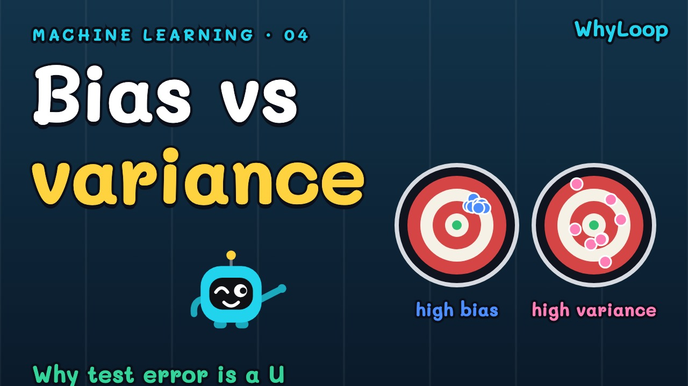
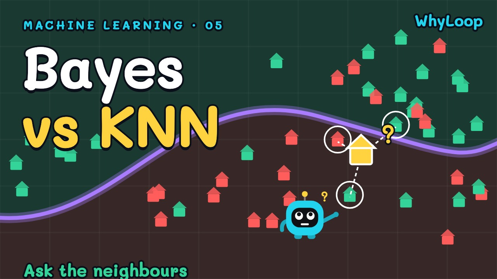
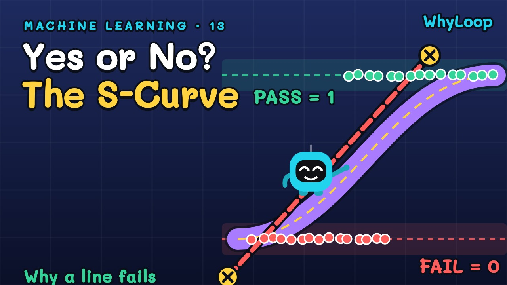
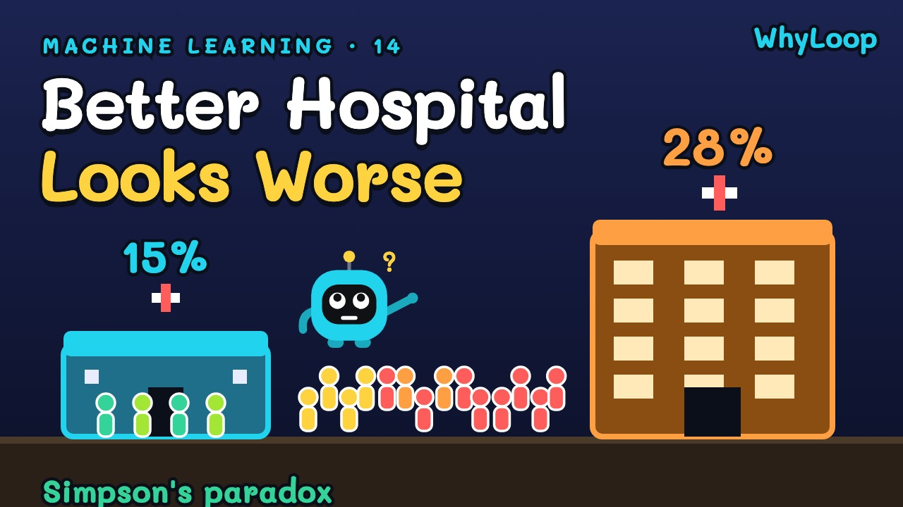
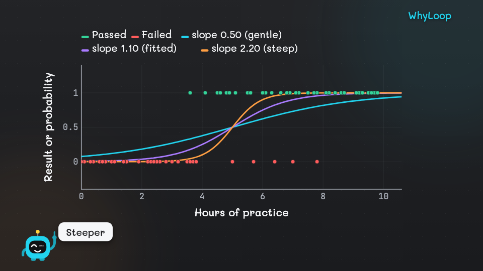
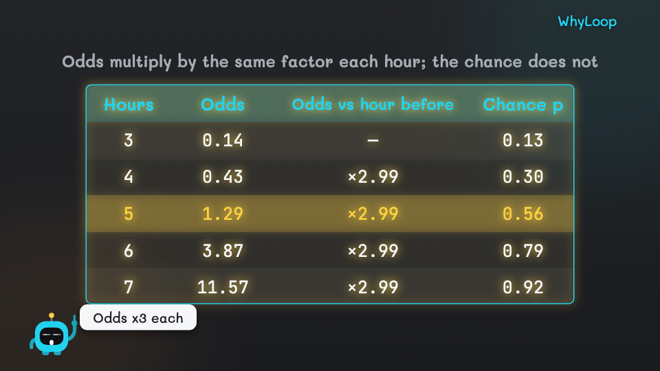

# 🔁 WhyLoop: Textbook-to-YouTube Explainer Video Pipeline

<div align="center">

[](scripts/make_video.py)
[](src/)
[](https://www.remotion.dev)
[](https://ffmpeg.org)
[%20%2B%20VieNeu%20(VI)-8B5CF6)](#3-audio-stack-narration-dub-and-music)
[](#-production-numbers--render-profile)
[](#4-pixel-level-layout-lint-the-render-gate)
[](https://www.youtube.com/channel/UCxnTeZD7YM3adHAdMTf2kpQ)
[](LICENSE)

<p align="center">
  <b>A one-person video studio written as code: it turns a chapter of a machine-learning textbook into a finished, bilingual YouTube episode (computed script, English narration, Vietnamese dub track, animated diagrams, music, thumbnail, captions and upload metadata), rendered entirely on a laptop.</b>
</p>

<p align="center"><i>"Ask why. Then ask again."</i></p>

[**🎬 Showcase**](#-showcase-thumbnails--real-frames) •
[**🏭 Architecture**](#-system-architecture--data-flow) •
[**🧩 Engines**](#-engines-deep-dive) •
[**🧭 Design Decisions**](#-design-decisions) •
[**📊 Numbers**](#-production-numbers--render-profile) •
[**🚀 Quickstart**](#-quickstart) •
[**🎨 Customise**](#-make-it-yours)

</div>

---

## 📌 Executive Summary

Making a good explainer video by hand means keeping four things in sync: the **numbers** on screen, the **words** in the voice-over, the
**animation timing**, and a **second language**. A single typo in one of them and the video says one number while showing another.

**WhyLoop** solves this by making **one JSON script the single source of truth** for both picture and sound:

1. **Computed content.** Each episode has a `gen_script.py` that simulates data, fits the models from scratch (for example logistic
   regression by Newton/IRLS) and writes `script.json`. Every number on screen and in the narration is the same computed value.
2. **Audio decides time.** Every *beat* (one short idea) is spoken first; its measured audio length becomes its length on screen, so the
   picture never runs ahead of or behind the voice.
3. **A render gate that looks at real pixels.** Before any render, the end of every beat is drawn in headless Chrome and measured;
   overlapping or clipped text blocks the build.
4. **Bilingual by construction.** The English picture and English audio are rendered once; a Vietnamese dub of exactly the same length is
   fitted beat by beat into the same time slots.

| | |
|---|---|
| 📺 **Episodes** | 14 public, 16 scripted (Machine Learning series, 36 planned) |
| 🎞️ **Content** | 967 animated beats in the 16 scripts, about 2.5 hours of rendered video |
| 🖥️ **Output** | 2560×1440 · 30 fps, English picture + English audio, plus a same-length Vietnamese audio track |
| 🧱 **Code** | ~7.5k lines of Python, TypeScript/React and JS (Python engine, Remotion front end) |
| 🎨 **Assets** | 752 licence-filtered colour icons, 9 visual themes, 10 script templates, 6 mascot characters |

---

## 🎬 Showcase: Thumbnails & Real Frames

Each thumbnail is a full-bleed **real-life metaphor** of the episode topic, drawn by code in [`src/Thumbnail.tsx`](src/Thumbnail.tsx)
(the mascot **Bít** is part of each scene):

<table align="center" width="100%">
  <tr>
    <td align="center" width="50%">
      <b>#04 · Bias vs Variance</b><br/>
      <br/>
      <em>Two dartboards: a tight cluster off-centre (bias) vs a scatter around the centre (variance).</em>
    </td>
    <td align="center" width="50%">
      <b>#05 · Bayes vs KNN</b><br/>
      <br/>
      <em>A town map: the new house asks its nearest neighbours; the purple road is the decision boundary.</em>
    </td>
  </tr>
  <tr>
    <td align="center" width="50%">
      <b>#13 · Yes or No? The S-Curve</b><br/>
      <br/>
      <em>Pass = 1 / Fail = 0 data: the straight red line overshoots, the purple S-curve fits.</em>
    </td>
    <td align="center" width="50%">
      <b>#14 · Better Hospital Looks Worse</b><br/>
      <br/>
      <em>Simpson's paradox: the big hospital's 28% looks worse than the clinic's 15%, until patients are split into groups.</em>
    </td>
  </tr>
</table>

### 🖼️ Frames Taken by the Layout Linter (Episode 13, Logistic Regression)

| Plot node: three slopes over the same data | Table node: odds multiply, chance does not |
| :---: | :---: |
|  |  |
| *The fitted slope (1.10) sits between a gentle and a steep guess; all three are computed, not drawn by hand.* | *Odds ×2.99 per hour, read straight from the fitted model; the highlighted row is the beat's focus.* |

Both frames were rendered and measured automatically before the episode was allowed to render.

---

## 🏭 System Architecture & Data Flow

### 📐 One Script Feeds Both Picture and Sound

<p align="center">
  
  <br/>
  <em>Figure 1: The script drives the picture track and the audio track; the red loop is the layout lint stopping a bad render before it starts. (Source: <a href="docs/gen_pipeline_svg.py">docs/gen_pipeline_svg.py</a>)</em>
</p>

### 🔄 What `./make-video render <episode>` Does



```mermaid
flowchart LR
    classDef srcStyle fill:#e0f2fe,stroke:#0284c7,stroke-width:2px,color:#0369a1;
    classDef gateStyle fill:#fef2f2,stroke:#dc2626,stroke-width:3px,color:#b91c1c;
    classDef audioStyle fill:#faf5ff,stroke:#9333ea,stroke-width:2px,color:#6b21a8;
    classDef videoStyle fill:#fff7ed,stroke:#ea580c,stroke-width:2px,color:#c2410c;
    classDef cacheStyle fill:#f1f5f9,stroke:#64748b,stroke-width:2px,color:#334155;
    classDef outStyle fill:#ecfdf5,stroke:#059669,stroke-width:3px,color:#047857;

    subgraph Authoring ["Authoring"]
        Gen["🧮 gen_script.py<br/>simulate + fit models"]:::srcStyle
        Script["📄 script.json<br/>nodes · edges · beats<br/>(text, text_vi, do)"]:::srcStyle
        Gen --> Script
    end

    subgraph Gates ["Quality Gates"]
        Check["✅ check<br/>schema · ending · pronunciation"]:::gateStyle
        Lint["🔍 lint<br/>headless Chrome, real boxes<br/>must print '0 vấn đề'"]:::gateStyle
        Check --> Lint
    end
    Script --> Check

    Brand["🎞️ Intro / Outro<br/>cached by SHA-1 key"]:::cacheStyle

    subgraph Content ["Content Render (primary language)"]
        TTS["🗣️ TTS per beat<br/>Kokoro (EN) / VieNeu (VI)"]:::audioStyle
        Time["⏱️ beat length =<br/>audio + gap (frames)"]:::audioStyle
        Remotion["🎬 Remotion render<br/>composition 'Main'"]:::videoStyle
        Mix["🎚️ Music mix<br/>−8 dB under voice, −16 LUFS"]:::audioStyle
        TTS --> Time --> Remotion --> Mix
    end
    Lint --> TTS
    Lint --> Brand

    Join["🔗 Join intro + content + outro<br/>(stream copy)"]:::cacheStyle
    Mix --> Join
    Brand --> Join

    subgraph Dub ["Dub (second language)"]
        DubTTS["🗣️ text_vi per beat"]:::audioStyle
        Fit["📏 fit into beat slot<br/>speed-up, then cut + report"]:::audioStyle
        DubMix["🎚️ audio-only render<br/>same sfx cues + music"]:::audioStyle
        DubTTS --> Fit --> DubMix
    end
    Time -.->|"beat slots"| DubTTS

    MP4["🚀 out/TAG.mp4<br/>EN picture + EN audio"]:::outStyle
    M4A["🎧 out/TAG.vi.m4a<br/>same length"]:::outStyle
    Join --> MP4
    DubMix --> M4A

    Pub["📤 captions · thumbnail · YouTube upload<br/>(dry-run first)"]:::outStyle
    MP4 --> Pub
    M4A --> Pub
```

### 🧬 Anatomy of a Beat

A video is a list of **beats**. Each beat is one short idea (8 to 20 words) and **must change something on screen**:

```json
{
  "text": "The request meets a load balancer, which picks a free server.",
  "text_vi": "Yêu cầu gặp bộ cân bằng tải, nơi chọn một máy chủ đang rảnh.",
  "do": { "show": ["n3", "b"], "flow": ["a", "b"], "highlight": ["n3"] }
}
```

| Field | Role | Who consumes it |
|---|---|---|
| `text` | On-screen language and main narration | TTS → frame timing → captions |
| `text_vi` | Vietnamese dub line, fitted into this beat's slot | `render_dub` |
| `do` | `show` · `hide` · `clear` · `highlight` · `flow` · `set` · `camera` | `DiagramScene` (picture) and `sfxFor` (sound effects) |
| `role` | `summary` / `question` on the last two beats (required) | `check` |

---

## 🧩 Engines Deep-Dive

The repository is split into a **Python engine** (orchestration, audio, gates, publishing) and a **Remotion front end** (everything you see).

### 1. Script Engine: Data-Driven Content
- **Per-episode generator** (`series/<s>/episodes/<ep>/gen_script.py`): fixed-seed synthetic data, models fitted in plain NumPy, narration
  written as f-strings over the computed values. `script.json` is generated, never hand-edited.
- **Layout grid** ([`scripts/make_video.py`](scripts/make_video.py), `resolve_layout`): nodes are placed with `col` 1 to 7 / `row` 1 to 5 on a
  1920×1080 design canvas instead of guessed pixel positions; the render is scaled up afterwards.
- **Icon resolution**: `brand:<name>` and built-in glyph names are swapped for original-colour artwork from the local library
  ([`assets/library/`](assets/library/)), copied into `public/lib/` only when a script uses them.

### 2. Scene Engine: Remotion + React
- **`DiagramScene`** ([`src/diagram.tsx`](src/diagram.tsx)): one diagram built up over many beats. At every frame it replays the `do` actions of
  beats 0..current to compute visibility, highlights, overrides and camera. The picture is a **pure function of the frame number**, which is
  why a still taken by the linter is identical to the frame in the final video.
- **13 node types**: `icon` · `box` · `group` · `cells` · `pill` · `text` · `code` · `badge` · `mascot` · `equation` (KaTeX) · `plot` (points,
  lines, functions, bars, segments, drawn in step by step) · `stat` (count-up numbers) · `table` (rows revealed by narration).
- **Automatic sound design** (`sfxFor`): `show` → pop, `highlight` → tick, `clear`/`camera` → whoosh, turning something red → buzz,
  other colour changes → ding, mascot expression → boop.
- **Mascot Bít** ([`src/mascot.tsx`](src/mascot.tsx)): 7 expressions, pointing poses and a speech bubble, fixed on screen (unaffected by camera).
- **Brand layer** ([`src/Video.tsx`](src/Video.tsx)): the channel avatar and name fly from the centre to the top-right corner after the intro
  and return for the outro.

### 3. Audio Stack: Narration, Dub and Music
- **English narration**: [Kokoro-82M](https://github.com/thewh1teagle/kokoro-onnx) (Apache-2.0) in its own venv, one model load per batch
  ([`scripts/kokoro_tts.py`](scripts/kokoro_tts.py)).
- **Vietnamese voice**: [VieNeu-TTS](https://github.com/pnnbao97/VieNeu-TTS) with voice cloning (`./make-video voice add`) and voice
  mixing (`config.json → voice_mixes`: 50% own voice + 50% preset), plus EQ/tempo presets.
- **Dub fitting** (`render_dub`, `fit_clip`): each Vietnamese line is sped up (pitch kept) up to `max_speedup` to fit its beat; if it still
  does not fit it is cut with a fade and listed in `out/work/<tag>.vi.report.json`, so the fix goes back into the script.
- **Pronunciation dictionaries** ([`pronunciation.json`](pronunciation.json), [`pronunciation.en.json`](pronunciation.en.json)): fix the
  channel name and technical terms; `check` warns about words the Vietnamese voice would spell out letter by letter.
- **Music**: instrumental beds generated locally with [ACE-Step 1.5](https://github.com/ace-step/ACE-Step-1.5); extended automatically when
  a video is longer than the base track, then mixed 8 dB under the voice and loudness-normalised to −16 LUFS.

### 4. Pixel-Level Layout Lint: the Render Gate
- [`scripts/lint_props.py`](scripts/lint_props.py) gives every beat a fixed length → [`scripts/lint_frames.mjs`](scripts/lint_frames.mjs)
  renders the frame just before each beat ends in headless Chrome, with the **same theme and font as the real render** → a probe inside
  `DiagramScene` logs the bounding box of every visible text, image and box → [`scripts/lint_report.py`](scripts/lint_report.py) reports
  text over text, text crossing a frame border, text off-screen, and text in the logo corner.
- `render` re-runs the lint itself and **refuses to start** unless the last line is `0 vấn đề` (0 problems). `--png` keeps one image per beat
  in `out/review/<episode>/` for a human look.

### 5. Brand Cache & Assembly
- Intro and outro are rendered **once** and cached under `assets/brand/build/<key>/`. The key is a SHA-1 over the UI source files, avatar,
  voice, voice effects, theme, render scale and pronunciation dictionary, so anything that changes their look or sound rebuilds them.
- Clips are loudness-normalised in two passes with a fixed audio format, which lets intro + content + outro be **joined by stream copy**
  (no re-encode); a re-encode fallback runs only if the copy is not clean.

### 6. Publishing Toolkit
- **Captions** ([`scripts/captions.py`](scripts/captions.py)): `captions.en.srt` and `captions.vi.srt` from the real beat timing of the last render.
- **YouTube** ([`scripts/youtube.py`](scripts/youtube.py)): Data API v3 upload with `--dry-run`, then thumbnail, captions and playlist as
  independent, resumable steps (`youtube resume`). OAuth secrets live in `~/.config/whyloop/`, never in the repo.
- **Bookkeeping** ([`scripts/episodes.py`](scripts/episodes.py)): episode status `planned → draft → scripted → rendered → published`, and a
  generated `catalog.md`.
- **Live progress page** ([`scripts/progress.py`](scripts/progress.py)): terminal bar, `out/work/progress.json` and a local web page with
  stages and ETA, safe for parallel renders.

---

## 🧭 Design Decisions

| Concern | Chosen approach | Rather than | Why |
|---|---|---|---|
| **Numbers in the video** | Computed by `gen_script.py`, narration as f-strings | Typing values into the script | Picture and voice cannot disagree; changing the data regenerates both |
| **Timing** | Measure each beat's TTS audio, then set its frame count | Fixed scene lengths | The animation always waits for the sentence to finish |
| **Layout QA** | Render real frames and measure DOM boxes | Estimating sizes from geometry | A label that wrapped onto the next icon passed the geometric check; real pixels catch it |
| **Second language** | Fit each dub line into its beat slot, report what had to be cut | Re-timing the video per language | One picture serves every language and YouTube gets a same-length audio track |
| **Intro / outro** | Cached clips, joined by stream copy | Re-rendering them every time | Saves render time; the cache key rebuilds them when anything relevant changes |
| **Render scale** | Design on 1920×1080, render with `scale` exactly 4/3 | Designing at 2560×1440 | Layout code stays simple; any other decimal gives Remotion a non-integer height |
| **Icons** | Local library limited to MIT / Apache-2.0 / CC0 / BSD / ISC | Fetching icons on demand | Reproducible renders and no per-icon attribution duties |

---

## 📊 Production Numbers & Render Profile

### 🎞️ Defaults That Shape Every Episode ([`config.json`](config.json))

| Setting | Value | Effect |
|---|:---:|---|
| Frame rate | `30 fps` | All timing is in frames |
| Render scale | `4/3` → `2560×1440` | Override once with `WHYLOOP_RENDER_SCALE=1\|2` |
| Gap between beats / after a scene | `0.45 s` / `0.6 s` | Breathing room after each sentence |
| Music level | `8 dB` under the voice | Measured per video from mean volumes |
| Loudness target | `−16 LUFS` | Two-pass `loudnorm` on intro/outro, one pass on content |
| Dub max speed-up | `1.15×` (EN) · `1.25×` (VI) | Beyond this the line is cut and reported |
| Demo length | `30 s` | `--mode demo` for a quick preview |

### ⏱️ Measured Render Time (macOS, Apple Silicon M4 Pro, 48 GB)

| Job | Time |
|---|:---:|
| Intro + outro build (first time, then cached) | `≈ 20 s` |
| Demo (~30 s of video) | `≈ 1 to 2 min` |
| Full 5-minute video | `≈ 3.5 to 5.5 min` |
| Extra when a longer music bed must be generated | `≈ +1 min` |

---

## 🚀 Quickstart

Developed and tested on **macOS (Apple Silicon)**. Linux and Windows are untested. Models are downloaded on first use, so the first run
needs internet and several GB of disk.

### 1️⃣ Install

```bash
brew install uv node ffmpeg espeak-ng       # espeak-ng is needed by the English voice (Kokoro)

git clone https://github.com/FluteInTheRain/whyloop.git && cd whyloop
./scripts/setup.sh    # clones VieNeu-TTS and ACE-Step into tools/, makes the Kokoro venv, npm install, builds sound effects
```

### 2️⃣ Things the Repo Does Not Ship

```bash
./make-video voice add my-voice.wav --name "Me"   # optional: clone your own Vietnamese voice (presets work without it)
uv run --project tools/acestep python scripts/gen_music.py --duration 40 --out assets/music/lofi_chill.wav \
  --caption "lo-fi hip hop, mellow electric piano, soft drums, warm vinyl texture, relaxed study beat"
./make-video brand build                          # intro and outro clips
npm run studio                                    # open Remotion Studio to check that rendering works
```

### 3️⃣ Run the Included Example (no private content needed)

```bash
./make-video check  examples/hello-whyloop                  # errors, layout and pronunciation warnings, length estimate
./make-video lint   examples/hello-whyloop --png            # must print "0 vấn đề" (= 0 problems)
./make-video render examples/hello-whyloop --mode demo \
    --voice "Hải Đăng" --music lofi_chill --no-dub           # ~30 s preview, English voice, no Vietnamese dub
```

`--voice "Hải Đăng"` is a built-in preset (the default `Khang Mix` is the author's own cloned voice). Results are written to `out/`.

Real output of the first command on this repo:

```text
 #  kind        từ  ~giây  lời đọc
 1  diagram     61   25.4  This is how a web request travels. Start with you and the app. The req…

Ước tính tổng: 0 phút 25 giây (25s) | mục tiêu: 0 phút 25 giây

Lồng tiếng vi: 6 beat có text_vi (đủ)

Intro tự động : WhyLoop — Ask why. Then ask again.
Màn hình kết  : câu hỏi "What if one server went down?"
Outro (đọc)   : Want to learn more about computer science? Subscribe to WhyLoop. See you next time!
```

And of the layout lint (6 beats rendered in headless Chrome and measured):

```text
6 beats -> out/work/lint/script.props.json

0 vấn đề ở 0/6 beat
```

### 4️⃣ Make Your Own Episode with Claude Code

Open Claude Code in the project folder and run `/make-video <topic>`. It writes `series/<series>/episodes/<NN-slug>/script.json`
(start from a file in [`templates/`](templates/)), then:

```bash
./make-video check  series/<series>/episodes/<episode>
./make-video lint   series/<series>/episodes/<episode> --png   # must print "0 vấn đề"
./make-video render series/<series>/episodes/<episode>         # re-runs the lint and refuses on problems
```

### 🐢 Weak Computer or Cloud

The heavy steps are music generation (ACE-Step wants a GPU or Apple Silicon), the Vietnamese dub (VieNeu) and frame rendering. Use your
own music file, skip the dub, and render small:

```bash
WHYLOOP_RENDER_SCALE=1 WHYLOOP_RENDER_CONCURRENCY=2 ./make-video render <episode> --voice "Hải Đăng" --music <name> --no-dub
```

On a rented Linux machine (untested by me) install `ffmpeg`, `espeak-ng`, Node 20+, `uv` and Chrome's system libraries, and set
`WHYLOOP_RENDER_GL=swangle` when there is no GPU. Remotion Lambda / Cloud Run are not wired into this pipeline.

---

## 🎨 Make It Yours

| I want to change... | Edit |
|---|---|
| The topic and the words | `script.json`: nodes on a grid, and beats (`text` = English, `text_vi` = Vietnamese dub, `do` = what changes on screen). Start from [`examples/`](examples/) or [`templates/`](templates/) |
| Computed numbers | Write a `gen_script.py` that simulates and fits, and let it write `script.json` |
| Colours and style | `config.json → theme` or `--theme dusk` (also `neon`, `terminal`, `ai`, ...); your own theme: copy a block in [`src/theme.ts`](src/theme.ts) |
| Channel name, tagline, font, avatar | `config.json → channel`, `assets/brand/avatar.png`, then `./make-video brand build --force` |
| Voice, music, language | `config.json → voices`, `music`; `meta.audio_langs` (`["en"]` for one language, or `--no-dub`) |
| Resolution | `config.json → render.scale`: `1` = 1080p, `4/3` = 2560×1440, `2` = 4K |
| Pronunciation | `pronunciation.json` (Vietnamese), `pronunciation.en.json` (English); hear a line with `./make-video say "..."` |

📘 Full guide (script format, themes, voices, cloud recipe, troubleshooting): **[docs/CUSTOMIZE.md](docs/CUSTOMIZE.md)** ·
Vietnamese operating manual with every command: **[docs/USAGE.md](docs/USAGE.md)**

---

## 📁 Repository Structure

```text
whyloop/
├── make-video                    # CLI entry point (runs scripts/make_video.py inside the VieNeu env)
├── config.json                   # Voices, music, timing, render scale, theme, channel identity, languages
├── pronunciation*.json           # Pronunciation fixes for the Vietnamese and English voices
├── scripts/                      # Python engine
│   ├── make_video.py             # check · lint · render · brand · say · voice (the orchestrator)
│   ├── lint_props.py             # Script → fixed-length timeline for the linter
│   ├── lint_frames.mjs           # Headless Chrome stills + element boxes per beat
│   ├── lint_report.py            # Boxes → overlap / overflow / off-screen problems
│   ├── kokoro_tts.py             # English TTS worker (own venv)
│   ├── gen_music.py              # ACE-Step music bed generator
│   ├── captions.py               # SRT captions from real beat timing
│   ├── youtube.py                # Upload, resume, captions, playlist, public
│   ├── episodes.py · book.py     # Episode status / catalog · book ingestion
│   ├── assets.py                 # Licence-filtered icon library (Iconify)
│   ├── progress.py               # Terminal + web progress page
│   └── setup.sh                  # Reinstall everything not stored in git
├── src/                          # Remotion front end (TypeScript + React)
│   ├── Root.tsx                  # Compositions: Main, Thumbnail, Avatar, Banner, Promo, sheets
│   ├── Video.tsx                 # Timeline of scenes, backdrops, flying brand tag
│   ├── diagram.tsx               # DiagramScene: beat state machine, edges, camera, lint probe
│   ├── math.tsx                  # Plot, equation (KaTeX), stat, table nodes
│   ├── scenes.tsx                # Stand-alone scene kinds, intro, end card, sign-off
│   ├── mascot.tsx · icons.tsx    # Mascot characters · glyphs and library icons
│   ├── theme.ts                  # 9 themes, brand fonts
│   └── Thumbnail.tsx             # Metaphor-scene thumbnails
├── templates/                    # 10 starter scripts (pipeline, compare-two, math-plot, ...)
├── examples/hello-whyloop/       # A 25-second bilingual episode that runs end to end
├── assets/                       # Brand, icon library (+ ATTRIBUTION.md), sound effects
├── promo/                        # Script and build step of the introduction video
├── docs/                         # USAGE.md, CUSTOMIZE.md, images
├── .claude/skills/               # /make-video and /plan-series skills
├── CLAUDE.md                     # Rules the AI assistant follows when making an episode
└── LICENSES.md                   # Licence and copyright review of every component
```

Episode folders (`series/`) and book material (`books/`) are kept out of this public repo; the videos are on the channel.

---

## 🧗 Engineering Challenges Solved

- **Layout bugs I could not see by eye.** A label wrapped onto the next icon and passed my first lint, which used the wrong theme. The lint
  now shares the exact theme and font of the real render.
- **Non-integer render height.** Rendering at 2K with a decimal scale made Remotion fail; the scale must be exactly 4/3.
- **Pronunciation.** The TTS read "WhyLoop" like "qui-loop". A pronunciation dictionary fixes the channel name and technical terms without
  matching single letters inside Vietnamese words.
- **Dub timing.** Vietnamese is longer than English. The dub is fitted per beat and reported, instead of stretching audio.
- **Copyright.** The source book is under copyright, so the repo stores only metadata. Episodes re-explain it with new examples and
  synthetic data, redraw every figure, and cite page numbers.

---

## 🤖 How AI Was Used

The episodes are written and rendered with **Claude Code**, driven by project skills ([`.claude/skills/`](.claude/skills/)) and the rules in
[`CLAUDE.md`](CLAUDE.md). The engineering decisions (data-driven scripts, pixel-level lint, bilingual dub fitting) are mine; the assistant
executes them under those rules.

## ⚠️ Limits

Visuals are vector animation only, with no live-action footage or AI-generated images. Narration length varies by 10 to 15% from the
estimate, and TTS pronunciation is not guaranteed. The Vietnamese preset voices have licence questions noted in [LICENSES.md](LICENSES.md).

---

## 👤 Author & Credits

- ★ **Nguyen Nhat Khang**: design, engine, scene system and every episode of the [WhyLoop channel](https://www.youtube.com/channel/UCxnTeZD7YM3adHAdMTf2kpQ).
- **Content** follows *An Introduction to Statistical Learning* (James, Witten, Hastie, Tibshirani; Springer, 2013), re-written with original
  examples.
- **Built on** Remotion, Kokoro-82M, VieNeu-TTS, ACE-Step and FFmpeg. Licences: [LICENSES.md](LICENSES.md).

---

## ⚖️ License

The source code is **MIT-licensed** ([LICENSE](LICENSE)). Not covered by it: the WhyLoop name, the mascot Bít and `assets/brand/` (all rights
reserved); the third-party icons in `assets/library/` (each set keeps its own licence, see
[`assets/library/ATTRIBUTION.md`](assets/library/ATTRIBUTION.md)); and the tools the project builds on (Remotion, VieNeu-TTS, ACE-Step,
Kokoro, FFmpeg). Remotion has its own terms for larger companies. Details: [LICENSES.md](LICENSES.md).

---
<div align="center">
  <sub>Built with ❤️ by Nguyen Nhat Khang • <i>Ask why. Then ask again.</i></sub>
</div>
